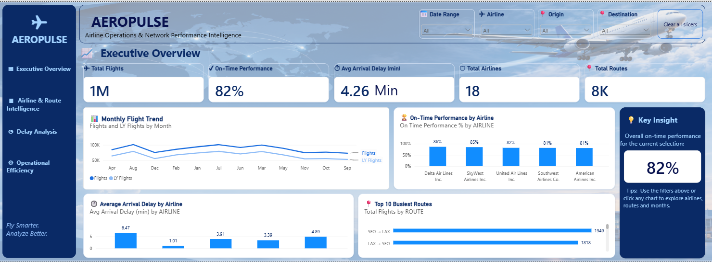
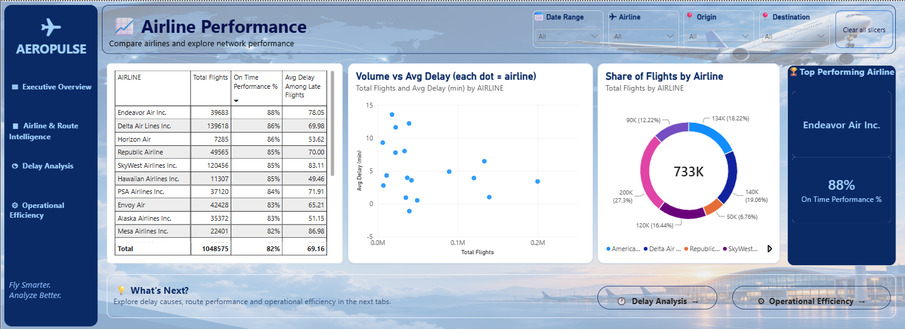
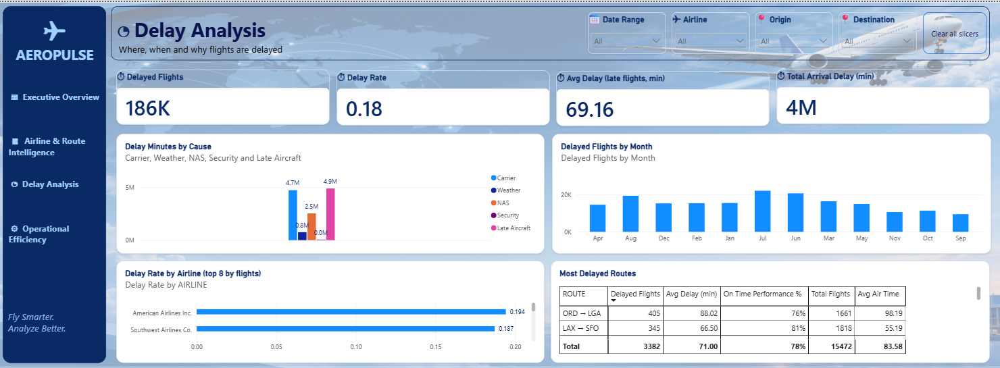
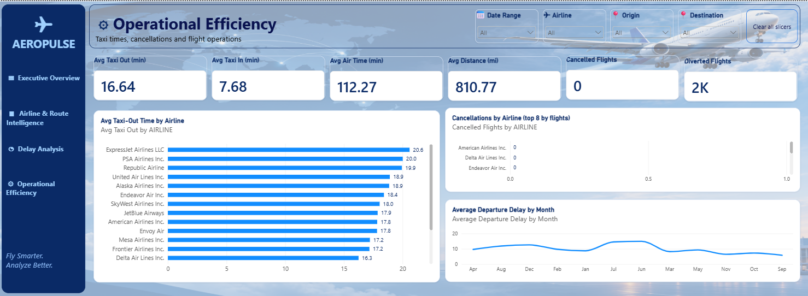

# AeroPulse | Aviation Performance Dashboard

*Fly Smarter. Analyze Better.*

An interactive Power BI report designed to analyze flight activity, airline performance, delays and operational efficiency. AeroPulse brings aviation KPIs and comparative visualizations into a four-page report to support performance monitoring and operational decision-making.

**Tools:** Microsoft Power BI Desktop • DAX measures • Data modeling • Interactive data visualization

## Business objectives

- Monitor flight volumes, routes, airline coverage and on-time performance.
- Compare airlines by punctuality, flight volume and average delay.
- Explore delay causes, monthly trends and route-level performance.
- Evaluate cancellations, diversions, taxi times and air time.

## Dashboard pages

> The images below are layout previews reconstructed from the supplied PBIX visual definitions. They are not live Power BI screenshots and do not display calculated values. Open the PBIX to see the actual charts and metrics.

### 1. Executive Overview

- Total flights, total routes, total airlines, on-time performance and average arrival delay.
- Monthly flight volume compared with previous-year flights.
- Airline-level arrival delay and on-time performance comparisons.
- Route-level flight volumes.

### 2. Airline Performance

- Top-performing airline and on-time performance indicators.
- Flight distribution by airline (donut chart).
- Flight volume versus average arrival delay (scatter chart).
- Airline comparison matrix showing total flights, on-time performance and average delay among late flights.

### 3. Delay Analysis

- Delayed flights, delay rate, average delay among late flights and total arrival delay minutes.
- Monthly delayed-flight trends and airline-level delay rates.
- Delay breakdown by carrier, weather, NAS, security and late aircraft.
- Route-level matrix with delay and flight performance measures.

### 4. Operational Efficiency

- Average taxi-in and taxi-out time, air time and distance.
- Cancelled and diverted flights.
- Airline-level cancellation and taxi-out comparisons.
- Monthly average departure delay trends.

## Data model

The PBIX model layout contains the following tables:

| Table | Role |
|---|---|
| `FactFlights` | Flight activity, delays, airline and route information |
| `DimDate` | Date-based analysis |
| `DimAirline` | Airline dimension |
| `DimOriginAirport` | Origin airport dimension |
| `DimDestAirport` | Destination airport dimension |
| `Measures table` | Centralized analytical measures |

## Interactive features

The report includes slicers for year/month, airline, origin city and destination city, as well as page navigation buttons. Visual types include KPI cards, line charts, clustered bar and column charts, a scatter chart, a donut chart and matrices.

## Analytical measures

- Total Flights, Total Routes, Total Airlines
- On Time Performance %, Previous Year Flights, Top Performing Airline
- Delayed Flights, Delay Rate, Avg Delay Among Late Flights, Total Arrival Delay Minutes
- Average Departure Delay, Avg Taxi In, Avg Taxi Out, Avg Air Time, Avg Distance

These are measure names referenced by the report visuals. Actual DAX expressions and numerical results have not been independently verified.

## Business applications

The report supports identification of high-delay routes, comparison of airline reliability, investigation of recurring delay causes and evaluation of ground-operation efficiency. These are intended uses, not claims of measured improvements.

## Repository files

- [AeroPulse_Dashboard.pbix](AeroPulse_Dashboard.pbix) — interactive Power BI report.
- `screenshots/` — reconstructed report layout previews.

## How to use

1. Download the PBIX file and open it in a compatible version of Microsoft Power BI Desktop.
2. Navigate through the four report pages using the navigation controls.
3. Apply slicers to explore airline, date and route performance.
4. To refresh the report, configure the original data source if required. A separate source dataset was not supplied.

## Author

Sakshi Jadhav
